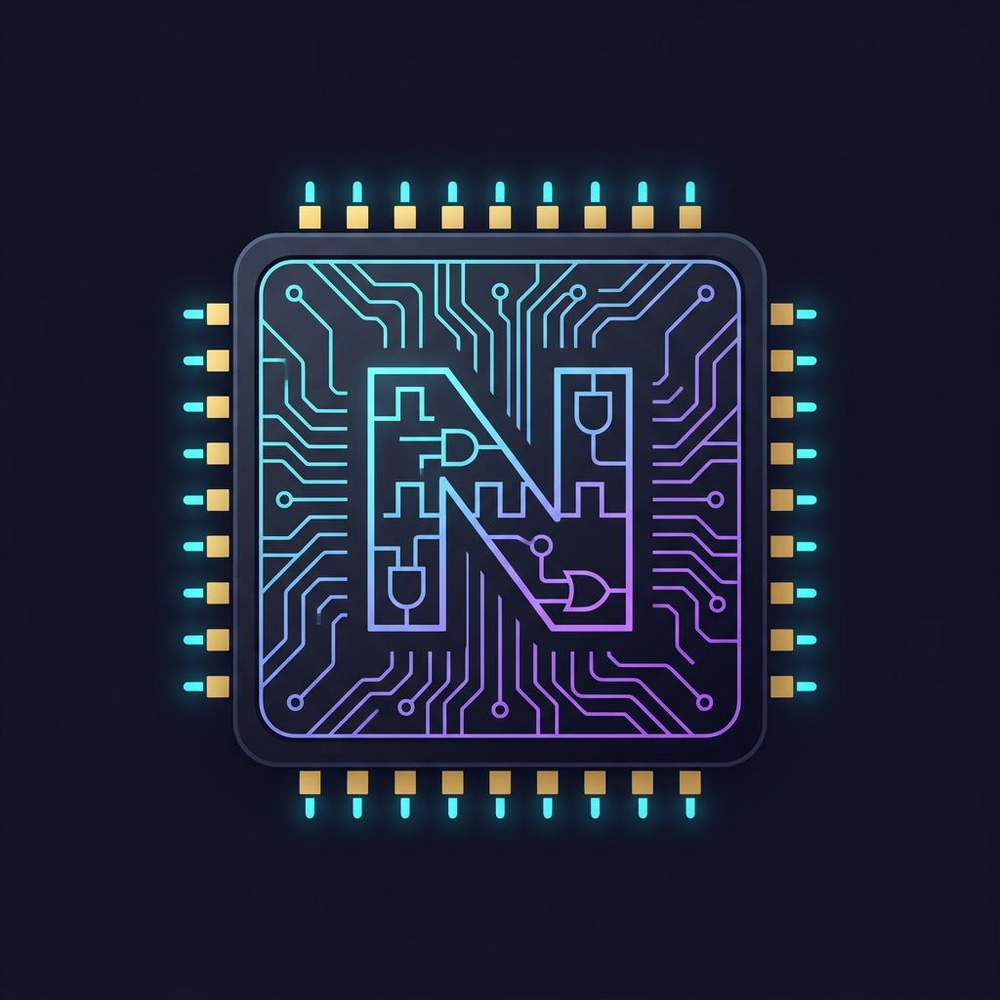
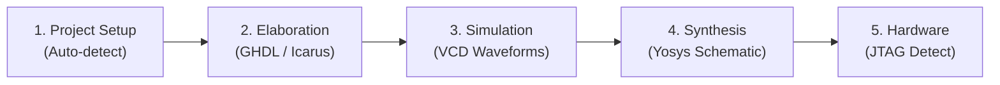

<p align="center">
  
</p>

# NoobEDA ⚡

> **The Zero-Bloat, Beginner-Friendly Cockpit for Open-Source FPGA & Digital Design**

[](https://www.python.org/)
[]()

Traditional vendor EDA software (Quartus, Vivado, ModelSim) takes **20–40 GB** of disk space, requires complicated license managers, and often abandons support for older hardware (such as Cyclone II boards).

**NoobEDA** is a lightweight, cross-platform graphical workbench that stitches the most powerful open-source hardware tools into a seamless, **1-click workflow**.

---

## 🚀 Features

- 📁 **Universal Workspace Adaptive**: Change folders anytime or run inside any project. Automatically detects VHDL (`.vhd`) and Verilog (`.v`, `.sv`) sources and testbenches.
- ⚡ **Instant Analysis & Elaboration**: Run fast syntax checks and submodule port bindings via GHDL or Icarus Verilog in < 2 seconds.
- 🔍 **Inferred Latch Detector**: Spot accidental asynchronous latches (missing `else` or default branches) before synthesis.
- 🧪 **1-Click Simulation → Waveforms**: Compile, simulate, and launch **GTKWave** or view interactive waveforms inside your editor via `.vcd`.
- 🎨 **RTL Vector Schematics**: Translates your behavioral HDL into interactive vector diagrams (`.svg`) via Yosys and netlistsvg with standard IEEE electronic logic symbols.
- 🔌 **Hardware JTAG Scanner**: Detect connected USB-Blaster, FTDI, or other programming cables using `openFPGALoader`.
- 🧠 **Embedded Decision Guide**: Diagnostic knowledge base covering active-low buttons, 7-segment displays, clock domains, and unused pin protection.

---

## 🛠️ Toolchain Under the Hood

NoobEDA acts as a graphical control deck over best-in-class open-source engines:

| Engine | Role in NoobEDA |
| :--- | :--- |
| **[GHDL](https://github.com/ghdl/ghdl)** | VHDL-2008 / VHDL-93 compilation, elaboration, and simulation |
| **[Icarus Verilog](https://github.com/steveicarus/iverilog)** | Verilog / SystemVerilog simulation and AST elaboration |
| **[GTKWave](https://gtkwave.sourceforge.net/)** | Full timing diagram and digital bus waveform inspection |
| **[Yosys](https://github.com/YosysHQ/yosys)** | RTL synthesis engine for gate mapping and structural extraction |
| **[netlistsvg](https://github.com/nturley/netlistsvg)** | High-quality electronic schematic renderer with standard IEEE symbols |
| **[openFPGALoader](https://github.com/trabucayre/openFPGALoader)** | Universal JTAG boundary-scan and FPGA bitstream flasher |

---

## 📦 Installation & Getting Started

### 1. Prerequisites
NoobEDA requires **Python 3.8+** (with Tkinter, which is included by default with standard Python installers).

Install the open-source EDA engines:
* **All-in-One (Recommended for Windows/Linux/macOS)**:
  Download the ready-to-run [OSS CAD Suite](https://github.com/YosysHQ/oss-cad-suite-build/releases/latest) or install via your system package manager:
  ```bash
  # Debian / Ubuntu
  sudo apt install ghdl iverilog gtkwave yosys nodejs npm
  npm install -g netlistsvg

  # Arch Linux
  sudo pacman -S ghdl iverilog gtkwave yosys nodejs npm
  npm install -g netlistsvg

  # macOS (Homebrew)
  brew install ghdl icarus-verilog gtkwave yosys node
  npm install -g netlistsvg
  ```

### 2. Clone and Run
```bash
git clone https://github.com/mouad11-11/NooBeda.git
cd NooBeda
python noobeda.py
```

---

## 🧭 The 5-Phase Workflow in NoobEDA



1. **Setup**: Select your working directory and designated top module.
2. **Elaborate**: Catch 95% of typos, missing semicolons, and port mismatches in seconds without running full synthesis.
3. **Simulate**: Run your testbench and view signal transitions in GTKWave with proper Hex/Decimal bus formatting.
4. **Schematic**: Generate vector SVGs to visually inspect your ALU arithmetic blocks, multiplexers, and state registers.
5. **Hardware**: Verify cable connectivity before programming silicon.
